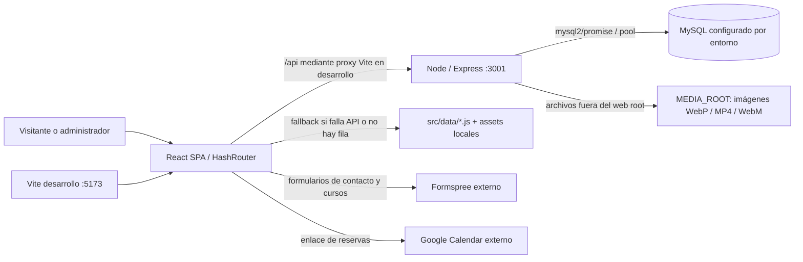
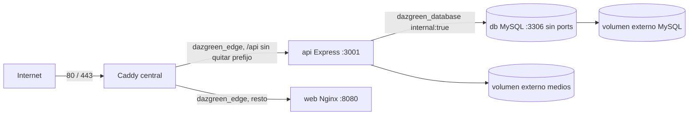

# DAZGREEN.COM — Auditoría técnica y preparación de despliegue

Fecha: 10 de octubre de 2026. Repositorio auditado: `D:\Proyectos\das-green-react`. Commit de referencia: `0a49f3b`, rama `main`; los archivos de preparación son cambios locales posteriores, sin commit ni push.

Alcance: inspección del código, configuración, dependencias, contratos HTTP/SQL y preparación de infraestructura. No se conectó a una base de producción, no se ejecutaron scripts de inicialización o importación, no se crearon/borraron volúmenes y no se desplegó. No se leyeron valores de secretos. No había un archivo `.env` local al comprobar su existencia.

**Actualización posterior por error de acceso (10 de octubre):** el usuario comunicó `401` repetidos en login y luego `429`, y confirmó haber ejecutado `admin:create` en el VPS. Las consultas HTTP de diagnóstico observaron `401` sin sesión, `404` de contenido y `401` de credenciales vacías, seguidos de `429` en texto inglés. Esto confirma rechazo de credenciales y bloqueo, pero no permite saber si la cuenta fue creada en la misma base ni comprobar la contraseña real. No se accedió directamente a MySQL de producción ni se restableció ninguna cuenta. Las referencias de líneas de la auditoría original más abajo corresponden al commit de referencia; la autenticación ahora se extrae a `server/auth-routes.js`. Se añadieron JSON español al limitador, exclusión de accesos exitosos, prevención de envíos duplicados, comprobación de cookie/respuesta válida y `admin:check` de solo lectura. `npm test`: 13 pruebas aprobadas con BD simulada; build aprobado (138 módulos, JS 336.86 kB / 104.85 kB gzip) y lint conserva 2 warnings anteriores. En esta revisión el daemon Docker local ya responde, aunque no se han construido/ejecutado imágenes nuevas ni probado el login con MySQL real. No se desplegaron las correcciones; los pasos de diagnóstico en la conexión del VPS están en README. El manifiesto solo añade scripts, sin cambiar dependencias.

## 1. Resumen ejecutivo

Se confirma una SPA React + Vite, una API Node.js + Express funcional a nivel de código y persistencia MySQL mediante `mysql2/promise`, sin ORM. La API escucha por defecto en **3001**; el build del frontend se genera en **`dist/`**. Evidencia: `package.json:6`, `vite.config.js:8`, `server/index.js:20`, `server/db.js:1` y compilación ejecutada.

La arquitectura admite `web` con Nginx, `api` con Express y `db` con MySQL privado, detrás de un Caddy central. Se prepararon esos archivos y un pipeline GitLab que construye imágenes en un runner externo y actualiza web/API por SSH. La base y los medios están en volúmenes externos: Compose exige que ya existan y no crea una base alternativa silenciosamente. MySQL no publica ningún puerto, ni siquiera sobre localhost.

**Estado: preparación estática validada; producción pendiente de validación con contenedores y de identificar/conservar los datos existentes.** El cliente Docker está instalado, pero el motor Linux de Docker Desktop no estaba disponible. Se pudieron validar Compose y YAML, compilar, hacer lint y auditar dependencias; no se pudieron construir/ejecutar imágenes, verificar Nginx/Caddy con sus binarios ni probar conexión/autenticación/cargas con MySQL real.

El remoto `origin` apunta a **github.com**, confirmado sin imprimir la URL ni credenciales. GitLab aún no es un destino de despliegue comprobado. Se corrigieron únicamente documentación y configuración de despliegue; no se cambió lógica de negocio ni dependencias.

## 2. Arquitectura actual real



La ubicación y versión de una base real no se pueden inferir del pool: este admite un host configurable y usa `127.0.0.1` si falta `MYSQL_HOST` (`server/db.js:4`). No hay prueba de que exista una instancia ni datos guardados. No hay Firebase/Supabase/serverless en el flujo actual de ejecución: las dependencias y los `fetch` observados usan Express. Las menciones de Firebase en comentarios/documentación describen la migración anterior y no prueban contenido histórico accesible.

`src/main.jsx:15` usa **HashRouter**: administración en `/#/admin`, acceso en `/#/login`. `src/App.jsx` compone la landing. `src/hooks/useContent.js:11` lee documentos; ante error/404 devuelve el estado local y las secciones conservan `src/data`. `useListContent.js:17` reconcilia listas por IDs `local-*`; las filas de fallback no se insertan automáticamente en MySQL.

`src/hooks/useContactForm.js:22` envía formularios a `site.formEndpoint`, definido en `src/config/site.js:14`. Los formularios no se guardan en MySQL ni los atiende Express. Calendar, fuentes de Google y enlaces sociales son otras dependencias externas del navegador, no servicios internos.

## 3. Inventario técnico

Las versiones exactas siguientes proceden de `package-lock.json` y de `npm ls --depth=0` después de `npm ci`. Los rangos declarados en `package.json` pueden resolver versiones superiores; por ejemplo React está declarado como `^19.2.8` y el lock resuelve `19.3.0`.

| Tecnología | Versión resuelta / configuración | Evidencia y uso |
| --- | --- | --- |
| React / React DOM | 19.3.0 / 19.3.0 | `package-lock.json:2932`, `src/main.jsx`; SPA |
| React Router DOM | 7.18.4 | `package-lock.json:2975`; HashRouter |
| Vite / plugin React | 8.3.1 / 6.1.1 | `package-lock.json:3520`, `vite.config.js`; salida `dist/`, sin `outDir` personalizado |
| Node local / npm local | 24.19.0 / 11.17.0 | `node --version`, `npm --version` |
| Node preparado en imágenes y CI | rama 24, Debian Bookworm slim | `Dockerfile.web`, `Dockerfile.api`, `.gitlab-ci.yml` |
| Express | 5.2.1 | `package-lock.json:1747`, `server/index.js` |
| mysql2 | 3.24.5 | `package-lock.json:2640`, `server/db.js`; consultas preparadas |
| Sharp / file-type / Multer | 0.35.5 / 22.1.1 / 2.4.0 | `package-lock.json:3140`, `:1845`, `:2579`; procesamiento y validación de medios |
| bcryptjs / jsonwebtoken | 3.0.3 / 9.0.3 | `server/auth.js`, `server/scripts/create-admin.js` |
| cookie-parser / express-rate-limit | 1.4.7 / 8.7.1 | `server/index.js:9`, `:11` |
| dotenv | 16.6.1 | importado al iniciar API y scripts administrativos |
| Oxlint / concurrently | 1.86.0 / 10.0.5 | scripts `lint` y `dev:full` |
| MySQL real | No comprobado | No hay conexión realizada, dump ni inventario de servidor |
| MySQL objetivo | imagen `mysql:8.4` | `compose.yaml`; MySQL 8.4, sujeto a prueba e identificación del origen |
| Nginx / Caddy objetivo | `nginx:stable-alpine` / `caddy:2-alpine` | Tags de infraestructura; digest y versión descargada no comprobados |
| Docker CLI / Compose local | 29.8.0 / 5.5.1 | comandos ejecutados; daemon no disponible |
| Git remoto actual | `origin` en github.com, rama `main` | inspección de Git con salida sanitizada |

| Script real | Comando | Resultado/propósito |
| --- | --- | --- |
| `dev` | `npm run dev` | Vite; normalmente 5173, puede elegir otro si está ocupado |
| `server` | `npm run server` | `node server/index.js`; puerto por defecto 3001 |
| `dev:full` | `npm run dev:full` | concurrently ejecuta frontend y API |
| `build` | `npm run build` | `vite build` → `dist/` |
| `preview` | `npm run preview` | vista previa del build; no es el servidor de producción |
| `lint` | `npm run lint` | Oxlint |
| `db:setup-local` | `npm run db:setup-local` | crea/actualiza base, usuario y administrador locales; NO usar en producción |
| `admin:create` | `npm run admin:create` | crea o cambia contraseña del administrador indicado; ejecutar solo cuando corresponda |

No hay un `package.json` separado en `server/`, ni un workspace backend. Los Dockerfiles usan el manifiesto y lock de la raíz. La API instala `npm ci --omit=dev`; algunos paquetes frontend siguen entre las dependencias productivas por el manifiesto compartido. No se dividió el manifiesto para evitar cambios innecesarios.

**Compatibilidad Node:** Vite exige `^20.19.0 || >=22.12.0`, pero `file-type@22.1.1` y `concurrently@10.0.5` exigen `>=22`. El proyecto completo debe usar al menos **22.12**, y la preparación usa **24**. Se corrigió la recomendación anterior de Node 20 en README. No se añadió un campo `engines` ni se cambió el lock.

## 4. Backend verificado

Existe Express ESM con entrada `server/index.js`. Carga entorno mediante `dotenv/config`, crea el directorio privado, valida cinco variables obligatorias y la longitud mínima del secreto JWT, inicializa tablas y luego llama a `app.listen` (`server/index.js:25`, `:214`, `:215`). Si MySQL falla, no empieza a escuchar. El puerto real por defecto es **3001** y coincide con el proxy de desarrollo; no se utiliza 3000.

| Método y ruta | Acceso | Evidencia / comportamiento |
| --- | --- | --- |
| `POST /api/auth/login` | público, origen validado, rate limit | `server/index.js:42`; SELECT administrador + bcrypt + cookie |
| `GET /api/auth/me` | JWT en cookie | `server/index.js:55`; 401 si no hay sesión válida |
| `POST /api/auth/logout` | origen validado | `server/index.js:63`; borra cookie, devuelve 204 |
| `GET /api/content/:id` | público | `server/index.js:68`; `{content, updatedAt}` o 404 |
| `PUT /api/content/:id` | administrador + origen | `server/index.js:77`; upsert JSON, prohíbe data URLs de imagen/video y limpia medios sin referencias |
| `POST /api/media` | administrador + origen | `server/index.js:119`; multipart `kind` + `file`, devuelve ID, URL, MIME y tamaño |
| `GET /api/media/:id` | público con UUID | `server/index.js:181`; archivo mediante `sendFile`, admite entrega parcial por mecanismo Express |
| `DELETE /api/media/:id` | administrador + origen | `server/index.js:194`; 409 si el archivo sigue referenciado |

No hay endpoint de salud dedicado ni endpoint propio para contacto, reservas o envío de acceso a cursos. El healthcheck preparado hace un GET a `/api/content/__docker_healthcheck__`: acepta 200/404 porque ambos prueban HTTP y la consulta a MySQL; 500 o timeout hacen fallar la salud. No crea ni modifica filas.

No hay middleware CORS. El frontend usa URLs relativas `/api`, con `credentials: "include"` en autenticación, guardado y carga (`src/admin/Login.jsx:15`, `ObjectEditor.jsx:48`, `ListEditor.jsx:140`, `src/utils/Uploadimage.js:101`). En producción Caddy sirve frontend y API bajo el mismo origen y redirige www al dominio principal; no requiere habilitar CORS ni almacenar credenciales de BD en React.

El login permite 10 intentos por IP en 15 minutos, en memoria de un proceso (`server/index.js:23`). JWT dura 8 horas y verifica issuer/audience (`server/auth.js:7`, `:29`); cookie `das_admin` es HttpOnly, SameSite Strict y Secure con `NODE_ENV=production`. No hay almacenamiento persistente de sesiones: los JWT siguen válidos tras reiniciar si se conserva el secreto. Rotarlo invalida sesiones existentes.

## 5. Base de datos MySQL

Conexión real implementada en `server/db.js:3`: pool `mysql2/promise`, puerto configurable (3306 por defecto), máximo 10 conexiones, charset utf8mb4. No hay Prisma, Sequelize, Knex ni modelos ORM. Las consultas del CRUD usan placeholders `?`.

| Tabla | Estructura principal | Evidencia |
| --- | --- | --- |
| `admins` | ID bigint, email único, `password_hash`, fecha | `server/db.js:16`, `server/sql/schema.sql` |
| `content` | ID varchar(100), `payload JSON`, `updated_at` | `server/db.js:24` |
| `media` | UUID, tipo imagen/video, MIME, nombre único, tamaño, fecha | `server/db.js:31` |

Las tablas son InnoDB. No existen migraciones versionadas ni seeds automáticos del contenido local. `initializeDatabase()` hace `CREATE TABLE IF NOT EXISTS`; no modifica una tabla existente para añadir columnas. `server/sql/schema.sql` crea además la base **das_green** y hace `USE das_green`: no ejecutar ese SQL sin adaptarlo si se elige otro nombre de base. No se monta ese archivo como importación automática.

`server/scripts/setup-local-db.js:56` cambia la contraseña del usuario local y `:85` hace upsert del administrador; `:111` modifica `.env` y `:117` imprime la contraseña inicial. Se inspeccionó, pero **no se ejecutó**. El guard de producción (`:9`) no justifica usarlo en el VPS. `create-admin.js:13` también cambia la contraseña si el email ya existe; no ejecutarlo automáticamente sobre una base restaurada.

Los datos reales no están verificados. El repositorio contiene fallbacks locales e imágenes, pero no una copia de filas `content`, metadata `media`, administradores reales o el storage privado. `docs/PROJECT_CONTEXT.md` describe documentos históricos en Firestore pendientes de exportación; no prueba que actualmente existan ni qué contienen. Hay que identificar la fuente autoritativa antes de publicar.

**Compatibilidad objetivo:** `mysql2@3.24.5` incluye `caching_sha2_password` en `node_modules/mysql2/lib/auth_plugins/index.js:4` y en su handshake. Esto da soporte de cliente al mecanismo moderno de MySQL; no equivale a una prueba de conexión. El esquema usa JSON/InnoDB compatibles a nivel de diseño con MySQL 8.4. No forzar `mysql_native_password` como solución. Si la fuente es MariaDB u otra versión, hacer exportación lógica y ensayo de restauración; no reutilizar su directorio físico con una imagen MySQL diferente. Las rutas de actualización admitidas deben revisarse según la versión real: [manual de actualización MySQL 8.4](https://dev.mysql.com/doc/refman/8.4/en/upgrading.html).

**Preservación de datos:** inventariar primero servidor/versión, tablas/columnas/conteos, archivos y UUIDs; hacer dump consistente más copia de `MEDIA_ROOT`, cifrar y sacar ambos del VPS; restaurar en un volumen nuevo e identificado para ensayar, comparar conteos y referencias; realizar el corte con escrituras detenidas. No importar sobre una base existente sin inventario y respaldo. Los dumps pueden incluir instrucciones de borrado: revisar el archivo antes de importar. La inicialización de la imagen y su script de permisos solo corren sobre un volumen vacío; las variables no rotan credenciales en una base ya inicializada. [Imagen oficial MySQL](https://hub.docker.com/_/mysql).

## 6. Variables de entorno

Los nombres y requisitos de aplicación provienen de `.env.example`, `vite.config.js`, `index.html`, `server/index.js`, `server/db.js`, `server/auth.js` y scripts administrativos. No se incluyen valores reales de secretos.

| Variable | Servicio | Propósito / requisito | Secreta |
| --- | --- | --- | --- |
| `NODE_ENV` | API/scripts | producción activa Secure y trust proxy; Compose lo fija | no |
| `PORT` | API | puerto de escucha; Compose fija 3001 | no |
| `APP_ORIGIN` | API | origen permitido para escritura; Compose fija dominio principal HTTPS | no |
| `JWT_SECRET` | API | obligatoria, mínimo 32 caracteres; generar secreto aleatorio distinto | **sí** |
| `MYSQL_HOST` | API | host del pool; Compose fija `db` | no |
| `MYSQL_PORT` | API | puerto interno del pool; Compose fija 3306 | no |
| `MYSQL_USER` | API/db | usuario dedicado; obligatorio en API, nunca root | no |
| `MYSQL_PASSWORD` | API/db | contraseña del usuario de aplicación; obligatoria | **sí** |
| `MYSQL_DATABASE` | API/db | base propia del proyecto; obligatoria | no |
| `MYSQL_ROOT_PASSWORD` | db / setup local | solo administración e inicialización de db; no entra en API/web | **sí** |
| `MEDIA_ROOT` | API | ruta privada persistente; Compose fija `/var/lib/dazgreen/media` | no |
| `MAX_VIDEO_BYTES` | API | límite de video, por defecto 150 MiB; mantener valor entero positivo | no |
| `ADMIN_EMAIL` | `admin:create` / setup local | correo para alta/cambio inicial; no requiere estar en API normal | dato privado |
| `ADMIN_PASSWORD` | scripts administrativos | contraseña de alta/cambio; mínimo 12 caracteres | **sí** |
| `VITE_BASE_PATH` | build frontend | base `/` para dominio raíz; Dockerfile la fija | no, pública |
| `VITE_SITE_URL` | build frontend | metadatos OG/Twitter/JSON-LD de `index.html`; Docker y CI fijan dominio HTTPS | no, pública |
| `WEB_IMAGE`, `API_IMAGE` | Compose/release | imagen local o imagen Registry con SHA | no |
| `PROXY_NETWORK` | Compose app | red externa a la que se conecta Caddy | no |
| `MYSQL_VOLUME_NAME`, `MEDIA_VOLUME_NAME` | Compose app | volúmenes externos concretos que se conservarán | no |

No usar `DB_HOST`: la aplicación lee **`MYSQL_HOST`**. No pasar variables MySQL, JWT ni contraseñas con prefijo `VITE_`: ese prefijo es público. La búsqueda en el bundle compilado no encontró referencias a `MYSQL_PASSWORD`, `MYSQL_ROOT_PASSWORD`, `JWT_SECRET` o `ADMIN_PASSWORD`; esto complementa, pero no reemplaza, la revisión del código.

`.env.example` conserva el flujo de desarrollo y añade `VITE_SITE_URL`. `deploy/.env.example` es una plantilla de producción separada, con secretos vacíos para que Compose rechace una configuración incompleta. Guardar el archivo efectivo como `/opt/dazgreen/.env.production`, con modo 600 y propietario de despliegue. No está incluido en imágenes, tar de CI ni Git. Los secretos de API/db se inyectan por entorno; un operador con acceso al daemon puede inspeccionarlos. No hay secret manager integrado y no se afirma lo contrario.

| Variable CI/CD | Propósito | Tratamiento |
| --- | --- | --- |
| `SSH_PRIVATE_KEY` | clave exclusiva del usuario de despliegue | variable GitLab tipo File, Protected, ámbito production; nunca imprimir |
| `SSH_KNOWN_HOSTS` | claves públicas del VPS verificadas previamente | File, Protected; verificación SSH estricta |
| `DEPLOY_HOST`, `DEPLOY_USER` | destino SSH (puerto 22 en esta plantilla) | Protected, ámbito production |
| `CI_REGISTRY*`, `CI_COMMIT_SHA`, `CI_DEFAULT_BRANCH`, `CI_COMMIT_REF_PROTECTED` | registro, tags y reglas | variables predefinidas GitLab; no duplicar secretos manualmente |
| `DOCKER_HOST`, `DOCKER_TLS_CERTDIR`, `DOCKER_TLS_VERIFY`, `DOCKER_CERT_PATH` | comunicación del runner con Docker-in-Docker por TLS | definidas en job images; runner debe compartir certificados |

## 7. Riesgos detectados

Severidad indica impacto potencial; se distingue código comprobado de condiciones pendientes. No se encontró un problema **CRÍTICO confirmado** como contraseña de BD incrustada en frontend o MySQL publicado. No se auditó todo el historial Git ni una infraestructura remota, por lo que esto no certifica ausencia histórica de filtraciones.

| Nivel | Ubicación / evidencia | Riesgo y acción |
| --- | --- | --- |
| **ALTO** | `docs/PROJECT_CONTEXT.md`, ausencia de exportación/importador histórico | fuente de contenido y medios sin confirmar; un sitio puede mostrar fallback y ocultar una migración incompleta. Inventariar y restaurar antes del corte |
| **ALTO** | motor Docker inaccesible / MySQL no probado | preparación sin ensayo de runtime; ejecutar builds y pruebas integrales en entorno aislado antes de producción |
| **ALTO** | `server/scripts/setup-local-db.js:56`, `:85`, `:117`; `create-admin.js:13` | reejecución cambia credenciales y setup local imprime contraseña. No ejecutar en CI/VPS; crear admin solo cuando se necesita y mantener terminal/log privados. No hay endpoint de cambio de contraseña en el panel |
| **MEDIO** | `server/db.js:15`, `server/sql/schema.sql` | esquema duplicado y sin migraciones versionadas; `IF NOT EXISTS` no actualiza tablas. Comparar esquema restaurado y diseñar migraciones antes de cambios futuros |
| **MEDIO** | `server/index.js:77`, `:94`, `:101` | publicación y borrado de medios no son una transacción y algunos errores unlink se silencian; posibles inconsistencias con fallos/concurrencia. Respaldar BD+medios juntos; futura limpieza diferida, coordinación y observabilidad |
| **MEDIO** | `server/index.js:119`, `:181` | subidas abandonadas pueden quedar sin referencia; cualquier UUID existente es legible públicamente, incluso antes de guardar contenido. No usar storage para documentos privados; prever limpieza controlada y capacidad |
| **MEDIO** | `server/auth.js:29`, `:51`, `server/index.js:55` | JWT no vuelve a comprobar existencia del admin; no hay revocación individual. Origin ausente no se rechaza, aunque SameSite Strict mitiga CSRF de navegador. Definir política de revocación/CSRF; rotar secreto si se requiere invalidar todas las sesiones |
| **MEDIO** | `server/index.js:208` | imprime objetos de error completos; podrían incluir SQL/datos en logs. Sanitizar logs en una tarea posterior, restringir lectura y retención |
| **MEDIO** | `src/admin/ObjectEditor.jsx:23`, `ListEditor.jsx:49`, `src/hooks/useContent.js:16` | lectura fallida silenciosa; un editor podría guardar fallback y reemplazar contenido remoto que no pudo cargar. Antes del corte probar lecturas/guardados y evitar editar con API degradada; futura distinción visible de error |
| **MEDIO, mitigado** | README antiguo y engines del lock | Node 20 no cumple todas las dependencias. Documentación corregida; imágenes/CI usan Node 24 |
| **MEDIO** | tags de imágenes en Dockerfiles/Compose/CI | tags de rama son móviles; resolver y fijar digests tras validar imágenes reales, especialmente MySQL. No hacer upgrades del motor implícitos sin backup y ensayo |
| **MEDIO** | `src/config/site.js:5`, `:11`, `:14` | correo de ejemplo, WhatsApp vacío, Formspree/Calendar no verificados. Confirmar canales y permisos de servicio con el dueño; no se enviaron formularios |
| **BAJO, parcialmente mitigado** | `index.html:26`, `:27`; no existe `public/og-image.jpg` | build sin VITE_SITE_URL dejaba placeholders. Docker/CI/.env.example ya lo configuran; falta aportar imagen OG válida |
| **BAJO** | `src/admin/FieldInput.jsx:4`, `Footer.jsx:23` | dos advertencias Oxlint preexistentes; no impiden build. Separar helper y corregir uso de Date en una tarea funcional posterior |
| **BAJO** | `src/admin/Login.jsx` | etiquetas sin htmlFor/ID asociado; revisar accesibilidad del login. No se modificó UI en esta preparación |

## 8. Dockerización



| Archivo preparado | Función |
| --- | --- |
| `Dockerfile.web` | build reproducible con lock, salida dist, Nginx como usuario nginx sobre 8080 |
| `Dockerfile.api` | instalación productiva, Node 24, usuario node, entrada real server/index.js |
| `.dockerignore` | excluye Git, entornos, dependencias locales, dist, medios, dumps y logs; se comparte entre ambos builds de contexto raíz |
| `.gitattributes` | conserva LF en scripts Linux aunque el checkout se haga en Windows |
| `deploy/nginx.conf` | SPA fallback, assets hash cacheables, HTML sin caché, /api devuelve 404 si se contacta web directamente |
| `compose.yaml` | web/api/db, límites de recursos, redes, volúmenes externos y orden por salud de db |
| `deploy/.env.example` | plantilla de producción sin secretos |
| `deploy/api-healthcheck.mjs` | comprobación de HTTP + consulta a BD sin escrituras |
| `deploy/mysql/10-limit-user.sh` | solo primer arranque vacío: valida identificadores y limita usuario a SELECT/INSERT/UPDATE/DELETE/CREATE en su base |
| `deploy/caddy/Caddyfile`, `deploy/caddy/sites/dazgreen.caddy` | dominio principal, redirección www y rutas API/frontend |
| `deploy/caddy/compose.yaml` | ejemplo opcional para proxy central nuevo, separado del proyecto |
| `.gitlab-ci.yml`, `deploy/release.sh` | verificación, construcción en CI, SSH y actualización sin importar/modificar BD |

También se actualizaron `.env.example`, `.gitignore`, README y `docs/PROJECT_CONTEXT.md`; se corrigieron referencias antiguas de puerto, hero y requisitos de Node. No había archivos Docker/Compose/Caddy/GitLab existentes que reemplazar en el árbol auditado.

**Servicios y salud:** web y api heredan healthchecks de sus Dockerfiles; db usa `SELECT 1` autenticado por TCP con el usuario de aplicación, no solo un ping que pueda responder con credenciales erróneas. API arranca después de db saludable. El proxy central se administra por separado. La caída posterior de db no reinicia automáticamente API por `depends_on`; los healthchecks detectan degradación y requieren monitorización. Un estado unhealthy tampoco activa por sí mismo `restart: unless-stopped`.

**Recursos:** web 128 MiB/0.25 CPU, api 768 MiB/0.75 CPU y db 1536 MiB/0.75 CPU; proxy opcional 256 MiB/0.25 CPU. Total de límites RAM de este ejemplo: **2688 MiB (2.625 GiB)**, dejando margen del VPS de 8 GB para SO y otros proyectos. CPU total con proxy: 2.0. Son límites iniciales, no resultados de una prueba de carga ni reservas exclusivas. MySQL usa buffer pool 512 MiB y 50 conexiones; un pool API ocupa hasta 10. Ajustar según uso y carga de Sharp/video. Storage/bandwidth/backup pueden ser el límite real; no se comprobó espacio del VPS.

**Persistencia:** base `dazgreen_mysql_data` y medios `dazgreen_media_data`, ambos externos. No cambiar nombres sin revisar qué datos contienen. El directorio preparado de medios en la imagen pertenece al usuario node (UID 1000 en esa imagen); revisar permisos al restaurar archivos. web/api usan raíz de filesystem de solo lectura, `/tmp` temporal, sin capabilities, y logs rotados. El binario de medios nunca entra a MySQL; solo metadata y URLs.

**Proxy:** Caddy va directamente a Express para conservar un único salto, acorde con `trust proxy=1` de `server/index.js:32`. No se encadena Nginx→Express. Se normaliza X-Forwarded-For a la IP que llega a Caddy. Si se introduce CDN/LB, hay que revisar confianza e IP real antes de activarlo; la configuración preparada supone Caddy como entrada directa. [Documentación oficial del reverse proxy Caddy](https://caddyserver.com/docs/caddyfile/directives/reverse_proxy).

## 9. Seguridad

MySQL es **exclusivamente interno en esta configuración Docker**: `db` no tiene `ports`, `network_mode: host` ni pertenencia a la red del proxy; pertenece solo a `dazgreen_database` con `internal: true`. No se publica 3306 en la IP pública ni sobre localhost y se desactiva el plugin MySQL X. web tampoco está en la red database. La API usa `MYSQL_HOST=db` y tiene además la red `dazgreen_edge` para recibir las solicitudes de Caddy. Los atributos fueron comprobados sobre la salida JSON de Compose sin imprimir secretos. [Redes Compose](https://docs.docker.com/reference/compose-file/networks/).

Ninguno de web/api/db publica puertos de host. Solo el proxy central opcional publica 80/443 TCP y 443 UDP. No se incluye phpMyAdmin ni se publica el puerto administrativo de Caddy. Un operador con acceso root al host/daemon sigue teniendo acceso administrativo a redes, volúmenes y entornos: el aislamiento evita exposición pública, no constituye protección frente al administrador del VPS.

La red de entrada propuesta es específica del proyecto. Para añadir otro proyecto, crear otra red de entrada y conectar el mismo Caddy a ella; no conectar sus bases a una red global. Si se decide compartir una única red de proxy, los contenedores de esa red pueden contactarse entre sí: revisar la confianza de todos sus miembros. Caddy conserva certificados/configuración en sus propios volúmenes persistentes.

El usuario app no recibe privilegios globales, GRANT OPTION ni administración del servidor. El script inicial reduce permisos a CRUD + CREATE por la inicialización del backend. En un volumen existente ese script NO se ejecuta: comprobar `SHOW GRANTS` y aplicar la política de permisos con un administrador después del backup. No se propagan credenciales root a API ni secretos a web. La conexión MySQL del código no configura TLS: el diseño la mantiene sobre la red privada del mismo host; si se mueve la BD fuera del host deberá añadirse TLS y una política de red antes de ese cambio.

La imagen frontend solo copia src/public/configuración explícita y no `.env`. `.dockerignore` bloquea entornos y medios para los dos Dockerfiles. `.gitignore` mantiene entornos privados/medios/backups/dumps fuera del versionado. No imprimir `docker compose config` completo ni activar trazas `set -x`/CI_DEBUG_TRACE con secretos. Usar `config --quiet` y salidas filtradas para inspección.

## 10. Despliegue en Hostinger KVM 2

Los comandos siguientes son un **procedimiento futuro**, no comandos ejecutados contra el VPS. Están destinados a Ubuntu 24.04 LTS con SSH. IP, usuario definitivo, DNS, almacenamiento actual y otros proyectos no se conocen. No sustituir el proxy existente ni reinstalar Docker si ya está funcionando. Los comandos Docker suponen un usuario autorizado a usar el daemon; pertenecer al grupo docker otorga control equivalente a root.

### 10.1. Inventario y preparación del host

1. Revisar versión Ubuntu, servicios/puertos, disco, memoria, Docker existente, contenedores/redes/volúmenes y proxy actual. Inventariar BD y medios en origen. Registrar la situación sin imprimir secretos. Respaldar antes de cambios.
2. Si es un Ubuntu nuevo sin Docker, instalar desde el repositorio oficial. Esta secuencia se basa en [Docker Engine para Ubuntu](https://docs.docker.com/engine/install/ubuntu/); revisar conflictos de paquetes antes de aplicarla a un host existente.

```bash
sudo apt update
sudo apt install -y ca-certificates curl
sudo install -m 0755 -d /etc/apt/keyrings
sudo curl -fsSL https://download.docker.com/linux/ubuntu/gpg -o /etc/apt/keyrings/docker.asc
sudo chmod a+r /etc/apt/keyrings/docker.asc
sudo tee /etc/apt/sources.list.d/docker.sources >/dev/null <<'EOF'
Types: deb
URIs: https://download.docker.com/linux/ubuntu
Suites: noble
Components: stable
Architectures: amd64
Signed-By: /etc/apt/keyrings/docker.asc
EOF
sudo apt update
sudo apt install -y docker-ce docker-ce-cli containerd.io docker-buildx-plugin docker-compose-plugin
sudo systemctl enable --now docker
sudo docker version
sudo docker compose version
```

`amd64` debe confirmarse con `dpkg --print-architecture`; si difiere, adaptar ese campo. No instalar GitLab Server ni un runner permanente en el KVM 2. Configurar acceso SSH por clave y firewall del proveedor/host para SSH y 80/443. Confirmar SSH antes de cambiar reglas. Los puertos publicados de Docker pueden eludir UFW; por eso la protección de MySQL aquí depende de ausencia de publicación y aislamiento de red, no de una regla UFW. [Limitaciones de firewall Docker](https://docs.docker.com/engine/install/ubuntu/).

### 10.2. Preparar proyecto y secretos

En la sesión del usuario de despliegue elegido, preparar `/opt/dazgreen` y subdirectorios. El siguiente ejemplo supone que esa sesión será la propietaria; la creación del usuario y su clave SSH se administra fuera del repositorio.

```bash
sudo install -d -m 0750 -o "$(id -un)" -g "$(id -gn)" /opt/dazgreen
mkdir -p /opt/dazgreen/releases /opt/dazgreen/backups
umask 077
```

Copiar a un primer directorio de release el repositorio revisado con estos cambios, sin `.env` local, dumps ni `private-media`. Completar la plantilla `deploy/.env.example` en `/opt/dazgreen/.env.production` mediante un editor privado, usando secretos aleatorios independientes; restringir permisos. No copiar esa plantilla vacía sobre un archivo privado existente. No se proporcionan comandos que impriman contraseñas.

```bash
chmod 600 /opt/dazgreen/.env.production
docker compose --env-file /opt/dazgreen/.env.production config --quiet
```

Ejecutar desde la raíz de la release que contiene `compose.yaml`. Los valores efectivos de nombres/secretos deben ser compatibles con la base que se restaurará. Para usuarios/nombres de BD, el script inicial admite letras, dígitos y guion bajo, sin root.

### 10.3. Crear red y volúmenes de forma consciente

Después de revisar redes/volúmenes existentes y decidir cuál es el destino, crear los nombres elegidos para una instancia NUEVA. Los comandos de ejemplo usan los nombres por defecto de la plantilla; no ejecutarlos por rutina si hay datos en otros volúmenes. Docker no borra un volumen al crearlo de nuevo con el mismo nombre, pero tampoco certifica que sea el volumen correcto.

```bash
docker network inspect dazgreen_edge
docker volume inspect dazgreen_mysql_data dazgreen_media_data
# Solo si no existen y se ha decidido crear un destino nuevo:
docker network create dazgreen_edge
docker volume create dazgreen_mysql_data
docker volume create dazgreen_media_data
```

No usar `docker compose down -v`, `docker volume prune`, importaciones automáticas ni reutilizar un datadir de otra versión/motor. Las referencias externas hacen que Compose falle si faltan volúmenes/red y protegen de creaciones implícitas con otro nombre. [Redes externas Compose](https://docs.docker.com/compose/how-tos/networking/).

### 10.4. Respaldar/restaurar antes de activar API

Si ya hay datos, hacer dump lógico y copia de medios en origen con escrituras detenidas o coordinadas. Para un servidor MySQL fuera de Docker, un operador puede usar `mysqldump -p` de manera interactiva; host/usuario/base deben proceder del inventario. Para MariaDB usar la herramienta adecuada y ensayar compatibilidad. Nunca pasar una contraseña literal en la línea de comandos ni publicar el dump.

Iniciar **solo db** en el destino revisado y esperar salud. Este paso crea una BD vacía únicamente si se eligió un volumen vacío, no importa ni sobrescribe datos por sí mismo:

```bash
docker compose --env-file /opt/dazgreen/.env.production up -d --wait --wait-timeout 240 db
```

Solo si el destino fue confirmado vacío y el dump fue revisado, un ejemplo de importación manual es:

```bash
docker compose --env-file /opt/dazgreen/.env.production exec -T db \
  sh -c 'MYSQL_PWD="$MYSQL_ROOT_PASSWORD" exec mysql -uroot "$MYSQL_DATABASE"' \
  < /opt/dazgreen/backups/origen-revisado.sql
```

No ejecutar esto sobre tablas existentes por defecto. Revisar que el dump no haga `USE` de otra base ni incluya usuarios/privilegios globales. Si se restaura desde Firestore, no existe un importador probado en este repositorio: preparar y validar primero el mapeo a `content`, convertir data URLs en archivos y reconciliar metadata `media`. No retirar la fuente anterior hasta validar el destino.

Copiar archivos antiguos a un directorio de restauración fuera del web root, preservando nombres de `storage_name`, y transferirlos al volumen de medios con un contenedor auxiliar y permisos UID/GID compatibles con node. No montar medios bajo Nginx/Caddy. Verificar conteos, tamaño, referencias y checksums; una copia de archivos sin filas `media` no habilita sus URLs.

Si se migra una base con administradores, conservar hashes y no ejecutar `admin:create`. Si no existe ninguno, crearlo deliberadamente después de preparar la imagen API en el paso siguiente; no añadir credenciales administrativas al servicio normal.

### 10.5. Construir/probar aplicación o usar imágenes de Registry

Primer ensayo manual, con código completo en la release (consume CPU; preferir construir en CI para producción):

```bash
docker compose --env-file /opt/dazgreen/.env.production build web api
docker compose --env-file /opt/dazgreen/.env.production up -d --no-build --wait --wait-timeout 240
docker compose --env-file /opt/dazgreen/.env.production ps
docker compose --env-file /opt/dazgreen/.env.production exec -T web nginx -t
```

Si se usan imágenes de GitLab, configurar `WEB_IMAGE`/`API_IMAGE` con los tags de SHA correspondientes y usar `pull web api` en lugar de construir en el VPS. Autenticar una sola vez al usuario de despliegue en Registry mediante deploy token de **solo read_registry**, con entrada privada `--password-stdin`; no usar una contraseña efímera de job como credencial permanente del VPS. Guardar su Docker config con permisos restringidos.

Solo si hace falta un administrador nuevo, este ejemplo solicita los datos en una terminal Bash privada y pasa nombres de variables, no contraseñas en argumentos. `admin:create` cambia la contraseña si el email ya existe:

```bash
read -r -p 'Correo del administrador: ' ADMIN_EMAIL
read -r -s -p 'Contraseña del administrador (mínimo 12 caracteres): ' ADMIN_PASSWORD
printf '\n'
export ADMIN_EMAIL ADMIN_PASSWORD
docker compose --env-file /opt/dazgreen/.env.production run --rm --no-deps \
  -e ADMIN_EMAIL -e ADMIN_PASSWORD api npm run admin:create
unset ADMIN_EMAIL ADMIN_PASSWORD
```

### 10.6. Proxy central, DNS y HTTPS

Si no existe Caddy, copiar `deploy/caddy/` a `/opt/proxy-central` y usar su Compose separado. Si ya existe, integrar el archivo de sitio y conectar su servicio a `dazgreen_edge` en la configuración persistente del proxy. Conservar todos los dominios/volúmenes existentes; no levantar otra instancia que compita por 80/443.

Crear registros A de `dazgreen.com` y `www.dazgreen.com` a la IP del VPS (www también puede ser CNAME). AAAA solo si IPv6 está configurado correctamente. Confirmar propagación y que 80/443 lleguen al Caddy; revisar cualquier CDN/proxy DNS antes de activarlo. Los dos dominios deben resolver para emitir sus certificados.

Para un proxy nuevo, desde `/opt/proxy-central`:

```bash
docker compose config --quiet
docker compose run --rm --no-deps caddy validate --config /etc/caddy/Caddyfile --adapter caddyfile
docker compose up -d
```

Para actualizar sitios del proxy ya activo, usar su directorio/Compose real:

```bash
docker compose exec -T caddy caddy validate --config /etc/caddy/Caddyfile --adapter caddyfile
docker compose exec -T caddy caddy reload --config /etc/caddy/Caddyfile --adapter caddyfile
```

Caddy obtiene/renueva certificados para los nombres configurados; preservar `/data`. La plantilla redirige www a `https://dazgreen.com`, manteniendo URI; el frontend funciona sobre `/` y escribe solo al origen principal. [HTTPS automático Caddy](https://caddyserver.com/docs/automatic-https).

### 10.7. Comprobación final, backups y habilitación del pipeline

Comprobar HTTPS, redirección www, `/#/login`, `/#/admin`, sesión HttpOnly/Secure, escrituras autorizadas y rechazo sin sesión, imágenes, video con Range, reemplazo/eliminación y conservación tras reiniciar. No modificar contenido real como prueba sin respaldo y un procedimiento acordado.

Inspeccionar MySQL sin revelar entorno: las salidas de `docker compose ps` y `docker inspect --format '{{json .NetworkSettings.Ports}}' ID_DB` no deben mostrar binding de host. Un `3306/tcp` sin dirección/puerto de host es solo metadata EXPOSE de la imagen. `docker port ID_DB` debe quedar sin publicación. Desde fuera del VPS, el puerto 3306 no debe ser alcanzable.

Para backups del destino Docker ya funcionando, detener temporalmente API durante la pareja dump+copia de medios; habrá una interrupción administrativa/lectura API y la landing conserva fallback. Ejemplo desde el directorio de release:

```bash
umask 077
docker compose --env-file /opt/dazgreen/.env.production stop api
docker compose --env-file /opt/dazgreen/.env.production exec -T db \
  sh -c 'MYSQL_PWD="$MYSQL_ROOT_PASSWORD" exec mysqldump -uroot --single-transaction --no-tablespaces --set-gtid-purged=OFF "$MYSQL_DATABASE"' \
  > /opt/dazgreen/backups/base-revisada.sql
# Crear una copia/tar del volumen de medios con un contenedor auxiliar antes de reactivar escrituras.
docker compose --env-file /opt/dazgreen/.env.production start api
```

Usar nombres fechados únicos para no sobrescribir backups, comprobar códigos de salida/tamaños y automatizar con reactivación garantizada en caso de error. El bloque es una secuencia ilustrativa, no un job de backup implementado. Cifrar/enviar ambos artefactos fuera del VPS, fijar retención y probar restauración regularmente en volúmenes aislados. No asumir que un snapshot del proveedor reemplaza el ensayo de restauración de BD+archivos.

Solo tras bootstrap, validación de datos y pruebas, crear el marcador que requiere el script de actualización:

```bash
touch /opt/dazgreen/.deployment-ready
chmod 600 /opt/dazgreen/.deployment-ready
```

## 11. Integración GitLab CI/CD

El remoto comprobado es GitHub. Crear/importar un proyecto GitLab o establecer un espejo según decisión del propietario; no se modificó `origin`, no se hizo push ni se probó acceso GitLab. Habilitar Container Registry y proteger rama principal/entorno production. No poner GitLab Server ni runner permanente en este VPS.

Pipeline preparado:

1. **verify**: Node 24, `npm ci`, lint, build con URL pública correcta y comprobación de sintaxis de API/healthcheck. No conecta a BD.
2. **images**: solo rama principal protegida; Docker-in-Docker por TLS, valida Compose, construye ambos Dockerfiles, ejecuta `nginx -t`, sintaxis shell y `caddy validate`, y publica tags de SHA. Requiere runner externo con modo privilegiado para DinD y volumen `/certs/client` compartido con el job. Confirmar disponibilidad/cuotas y arquitectura amd64. No se ha ejecutado este pipeline en GitLab.
3. **deploy_production**: job manual, rama protegida, `resource_group` para serializar. SSH con clave File y known_hosts previamente verificado. El tar contiene únicamente Compose, script de release y script de permisos, no secrets ni datos. No cambia el Caddy central.
4. **release.sh**: exige `/opt/dazgreen/.env.production`, marcador de preparación y db existente/healthy. Descarga las imágenes concretas y ejecuta `up --no-build --no-deps --wait web api`. No levanta/actualiza db, no importa SQL y no llama a admin:create. Guarda referencias current/previous y enlace current solo si la actualización termina correctamente.

La clave SSH debe ser exclusiva para este despliegue y estar autorizada en el usuario elegido. Las variables File conservan saltos de línea; las claves privadas multilinea no siempre son compatibles con Masked, por lo que deben ser Protected y no imprimirse. No usar `ssh-keyscan` dentro del job ni desactivar StrictHostKeyChecking. [SSH seguro en GitLab CI/CD](https://docs.gitlab.com/ci/jobs/ssh_keys/).

El despliegue con Compose puede tener una breve interrupción; no es rolling/blue-green. Si `up --wait` falla, el job falla pero algunos servicios podrían haberse actualizado; no hay rollback automático. Revisar estado/logs y volver a imágenes previas con el Compose de la release correspondiente. `previous-images.env` solo se genera cuando ya existe una actualización previa exitosa; para el primer corte registrar manualmente las imágenes anteriores.

Rollback de aplicación, después de revisar compatibilidad de esquema (no se restaura ni se baja de versión db):

```bash
docker compose --env-file /opt/dazgreen/.env.production \
  --env-file /opt/dazgreen/previous-images.env \
  -f /opt/dazgreen/current/compose.yaml \
  up -d --no-build --no-deps --wait web api
```

Si también cambió el Compose/código de infraestructura, elegir la release anterior correcta en `-f`. El rollback de datos necesita una restauración aparte en un destino controlado; no ejecutar comandos de borrado para conseguirlo.

## 12. Verificaciones ejecutadas

Se ejecutaron en el entorno local Windows. Las variables usadas para `compose config` fueron placeholders de auditoría inyectados en el proceso, no credenciales reales. Los comandos VPS/pipeline de secciones anteriores no se ejecutaron.

| Prueba / comando real | Resultado |
| --- | --- |
| `git status --short`, `rg --files`, lecturas de manifiesto/config/API/SQL/hooks/editores/presentación | árbol inicial limpio; arquitectura y contratos revisados; sin infraestructura Docker previa |
| `git log -1`, `git branch --show-current`, inspección sanitizada de host remoto | referencia 0a49f3b, main, github.com |
| `node --version`, `npm --version` | 24.19.0 / 11.17.0 |
| `npm ci --no-fund --no-audit` | **aprobada**, 167 paquetes; no se cambiaron manifiesto/lock |
| lectura de engines del lock, `npm ls --depth=0` | **aprobada**, árbol consistente; Node 20 insuficiente para proyecto completo |
| `npm run build` inicial | **aprobada con advertencias**, faltaba VITE_SITE_URL en el entorno |
| `npm run build` con VITE_SITE_URL configurada | **aprobada sin advertencias de variables**; 137 módulos, JS 335.54 kB / 104.35 kB gzip; CSS 44.04 kB / 9.45 kB gzip |
| inspección de `dist/index.html` | **aprobada** sustitución de variables; **pendiente/faltante** `dist/og-image.jpg` |
| búsqueda de nombres de secretos servidor en JS compilado | **aprobada**, cero referencias a las cuatro variables secretas comprobadas |
| `npm run lint` | **aprobada con 2 warnings preexistentes**, FieldInput y Footer |
| `npm audit --omit=dev` y `npm audit` | **aprobadas**, 0 vulnerabilidades reportadas por registry en esta ejecución; no es prueba de ausencia de fallos de negocio |
| `node --check` de index/db/auth/setup-local/create-admin/healthcheck | **aprobadas** |
| Git Bash `bash -n deploy/release.sh` y `bash -n deploy/mysql/10-limit-user.sh` | **aprobadas** |
| parser YAML: `Get-Content -Raw ARCHIVO \| npm exec --yes --package=yaml -- yaml valid` | **aprobados** `.gitlab-ci.yml`, `compose.yaml`, `deploy/caddy/compose.yaml`; parser temporal, sin añadir dependencia al proyecto |
| conversión YAML→JSON y comprobación de tipos de comandos CI con Node | **aprobada**: script/before_script de los tres jobs contienen strings, sin mappings accidentales |
| inspección de LF en scripts, estructura del informe y `git check-ignore` | **aprobadas**: 15 apartados, scripts LF; entornos de producción, backups y medios ignorados |
| `docker --version`, `docker compose version` | cliente 29.8.0 y Compose 5.5.1 disponibles |
| `docker compose --env-file deploy/.env.example config --quiet` con entorno de auditoría | **aprobada** sintaxis/interpolación app |
| `docker compose -f deploy/caddy/compose.yaml config --quiet` | **aprobada** proxy opcional |
| `docker compose ... config --format json` + inspección filtrada/assertions Node | **aprobada**: ningún servicio app publica ports; db solo network database; database.internal=true; volúmenes external=true |
| revisión de mysql2 instalado | **aprobada** presencia de caching_sha2_password; conexión real no realizada |
| `docker info` | **fallida por entorno**, no existe pipe dockerDesktopLinuxEngine; daemon Linux no activo |
| `git diff --check` | **aprobada** para cambios registrados |

**No realizadas:** builds de Docker, `nginx -t` con binario de imagen, `caddy validate` con binario de imagen, arranque Compose, SQL contra MySQL 8.4, esquema/permisos de usuario reales, login/endpoints/medios integrales, pruebas de Range/proxy/HTTPS, restauración/backups, CI Lint de GitLab, ejecución del pipeline, DNS/Hostinger y carga del VPS. YAML válido no certifica la semántica de GitLab ni la disponibilidad del runner. Compose válido no certifica funcionamiento de las imágenes. No se inició el servicio Docker Desktop para sortear ese límite.

## 13. Checklist de despliegue

- [x] Confirmar frontend, backend, API y librería MySQL desde código.
- [x] Verificar puerto real, build y requisitos Node.
- [x] Preparar Dockerfiles, ignore, Nginx, Compose y plantilla de entorno.
- [x] Mantener MySQL sin puertos publicados y en red interna.
- [x] Preparar proxy central y pipeline sin secretos ni datos.
- [x] Ejecutar build, lint, audit y validaciones estáticas disponibles.
- [ ] Identificar base/datos/medios actuales y posible fuente Firestore; decidir origen autoritativo.
- [ ] Hacer respaldo y ensayar restauración en volumen nuevo, incluyendo archivos/UUIDs.
- [ ] Activar motor Docker en un entorno aislado y ejecutar builds, Nginx/Caddy y pruebas integrales con MySQL 8.4.
- [ ] Confirmar versión/esquema/credenciales compatibles y permisos limitados sobre base restaurada.
- [ ] Crear/configurar GitLab, Registry, rama y entorno protegidos, runner externo con DinD TLS.
- [ ] Confirmar IP/SSH, servicios existentes, disco y proxy central del VPS.
- [ ] Provisionar red/volúmenes concretos y archivo privado de producción; no reutilizar secretos locales.
- [ ] Restaurar datos, verificar referencias y preparar administrador solo si hace falta.
- [ ] Configurar DNS A/AAAA según conectividad real y validar certificados/redirección.
- [ ] Confirmar login, escrituras, cargas, video Range, fallback y persistencia tras reiniciar.
- [ ] Revisar Formspree/Calendar/contactos y aportar og-image.jpg.
- [ ] Configurar backups fuera del VPS, retención, monitorización y rollback probado.
- [ ] Crear marcador de bootstrap y habilitar job manual de despliegue.

## 14. Preguntas o bloqueos

Información que no está en el repositorio y no se puede completar con seguridad mediante inferencias:

1. ¿Dónde están los datos autoritativos actuales: MySQL/MariaDB, Firestore o solo datos locales? Se necesita versión del motor, inventario/dump y copia de medios mediante un canal privado; no pegar secretos en el informe/chat.
2. ¿Cuál será el proyecto/Registry GitLab y qué runner externo está disponible para DinD TLS? El remoto actual es GitHub.
3. ¿Cuál es la IP, el usuario/puerto SSH y qué servicios/proxy/volúmenes ya existen en el VPS? La plantilla CI usa 22 y `/opt/dazgreen`.
4. ¿Quién administra DNS y existe CDN/proxy delante del dominio? La configuración preparada supone conexión directa a Caddy.
5. ¿Qué destinos y retención de backup, ventana de corte y contactos/servicios Formspree/Calendar se usarán? No se comprobaron cuentas externas.

Bloqueo técnico local observado: daemon Docker Linux no disponible. No impidió preparar/validar configuración estática, pero impide afirmar que el despliegue funciona de extremo a extremo. La integración de datos históricos y la infraestructura real no deben darse por completas.

## 15. Resumen para ChatGPT

> **Contexto autosuficiente para continuar**
>
> Proyecto en `D:\Proyectos\das-green-react`, SPA pública y panel en español. Referencia auditada 0a49f3b, main; remoto origin en github.com. Preparación Docker local sin commit/push/despliegue. No hay .env local ni conexión MySQL verificada en esta auditoría.
>
> Arquitectura confirmada: React/React DOM 19.3.0, Vite 8.3.1, React Router 7.18.4 HashRouter; API Node ESM/Express 5.2.1, mysql2 3.24.5 sin ORM, Sharp/Multer/file-type para medios. Formularios a Formspree; reservas por enlace Google Calendar. Fuente de datos histórica desconocida; docs indican posible migración de Firestore pendiente.
>
> Estructura: raíz package.json/package-lock.json/vite.config.js/index.html; `src/` contiene App/main, admin, components, hooks, data, config y utils; `public/` assets estáticos; `server/` index.js/db.js/auth.js, scripts create-admin/setup-local-db y sql/schema.sql; `docs/PROJECT_CONTEXT.md` mapa de contratos; `deploy/` nueva infraestructura. No existe package.json separado de backend.
>
> Comandos reales: `npm ci`; frontend `npm run dev`; API `npm run server` = `node server/index.js`; conjunto `npm run dev:full`; build `npm run build` a dist; lint `npm run lint`. API 3001 por defecto, configurable PORT; Vite normalmente 5173, proxy /api a localhost:3001. HashRouter: /#/login y /#/admin. Usar Node >=22.12, imágenes/CI Node 24. No ejecutar db:setup-local en producción: cambia credenciales/upsert y muestra contraseña inicial. admin:create también cambia contraseña de email existente.
>
> Rutas: POST /api/auth/login; GET /api/auth/me; POST /api/auth/logout; GET y PUT /api/content/:id; POST /api/media (multipart kind/file), GET y DELETE /api/media/:id. PUT/carga/borrado requieren sesión JWT HttpOnly, Secure producción, SameSite Strict, TTL 8h; middleware de origen. Lecturas públicas. No hay CORS ni endpoint health/contacto propio. Frontend usa /api relativo y mantiene fallbacks src/data si lectura falla.
>
> Entorno API: MYSQL_USER, MYSQL_PASSWORD, MYSQL_DATABASE, JWT_SECRET (>=32), APP_ORIGIN obligatorias; MYSQL_HOST/PORT, PORT, NODE_ENV, MEDIA_ROOT, MAX_VIDEO_BYTES opcionales/configurados. Build VITE_BASE_PATH y VITE_SITE_URL. Scripts de admin requieren ADMIN_EMAIL/ADMIN_PASSWORD (>=12). Producción usa archivo privado /opt/dazgreen/.env.production a partir de deploy/.env.example, con MYSQL_ROOT_PASSWORD solo para db, volúmenes/red y WEB_IMAGE/API_IMAGE. No usar DB_HOST ni secretos VITE_.
>
> BD: content JSON por id, media metadata UUID/nombre/MIME/tamaño, admins hash bcrypt. initializeDatabase crea tablas IF NOT EXISTS, sin migraciones versionadas ni seed de fallbacks; schema.sql fija das_green. No se comprobó instancia, versión, filas o archivos históricos. Imágenes cargadas se convierten WebP, videos MP4/WebM quedan privados bajo MEDIA_ROOT; límite 15 MiB fuente imagen / 150 MiB video por defecto. BD y archivos se respaldan/restauran juntos. Al guardar se borran medios ya no referenciados; no hay transacción conjunta ni limpieza de subidas abandonadas.
>
> Archivos preparados: Dockerfile.web, Dockerfile.api, .dockerignore, .gitattributes, compose.yaml, deploy/nginx.conf, deploy/.env.example, deploy/api-healthcheck.mjs, deploy/mysql/10-limit-user.sh, deploy/caddy/Caddyfile, deploy/caddy/sites/dazgreen.caddy, deploy/caddy/compose.yaml opcional, .gitlab-ci.yml y deploy/release.sh. También ajustes mínimos de .env.example/.gitignore/README/contexto. La lógica funcional/dependencias no cambió.
>
> Objetivo: Caddy central 80/443 → web Nginx8080 o api Express3001 directo (trust proxy=1). App no publica puertos. db mysql:8.4 solo en red database internal:true; API además tiene red externa dazgreen_edge. MYSQL_HOST=db. No phpMyAdmin ni 3306 público/localhost. Volúmenes externos dazgreen_mysql_data y dazgreen_media_data, creados conscientemente tras revisar datos. Usuario app solo CRUD+CREATE de su BD en inicialización vacía; revisar grants de restaurada. Límites iniciales web128MiB/api768MiB/db1536MiB/Caddy256MiB, suma 2688MiB; no medidos con carga.
>
> Validado: npm ci/build (335.54kB JS /104.35kB gzip), lint con 2 warnings FieldInput/Footer, npm audit completo/productivo sin vulnerabilidades, Node checks, bash -n scripts, YAML y docker compose config de app/proxy. JSON Compose confirma db sin ports/red privada. Build con VITE_SITE_URL sustituye metadatos; og-image.jpg falta. mysql2 tiene caching_sha2_password; conexión no probada. Motor Docker local no activo: NO se probaron imágenes, nginx -t, caddy validate, SQL/runtime/endpoints ni HTTPS/pipeline. GitLab semántico/runner no verificados.
>
> CI propuesta: verify → images en runner externo DinD TLS → deploy manual/protected por SSH con File SSH_PRIVATE_KEY y SSH_KNOWN_HOSTS; DEPLOY_HOST/USER. Registry imágenes por SHA, VPS con token read_registry privado. release.sh exige db saludable existente y /opt/dazgreen/.deployment-ready tras bootstrap; solo actualiza web/api --no-deps. No importa DB ni cambia admin/Caddy. No hay rollback automático ni cero downtime.
>
> Próximos pasos: identificar fuente/versión y backup de BD+medios; ensayo en volumen aislado; activar motor Docker y validar imágenes/runtime; crear GitLab/Registry/runner; inventariar VPS Ubuntu24.04 KVM2 y proxy/DNS; provisionar red/volúmenes/secretos; restaurar sin sobrescribir; configurar Caddy y HTTPS; pruebas del panel/medios/persistencia; backups fuera del VPS y monitorización; marcador y pipeline manual. No instalar GitLab Server/runner permanente en VPS. No desplegar, importar o borrar datos sin la fase de preparación correspondiente y autorización de esa tarea.
